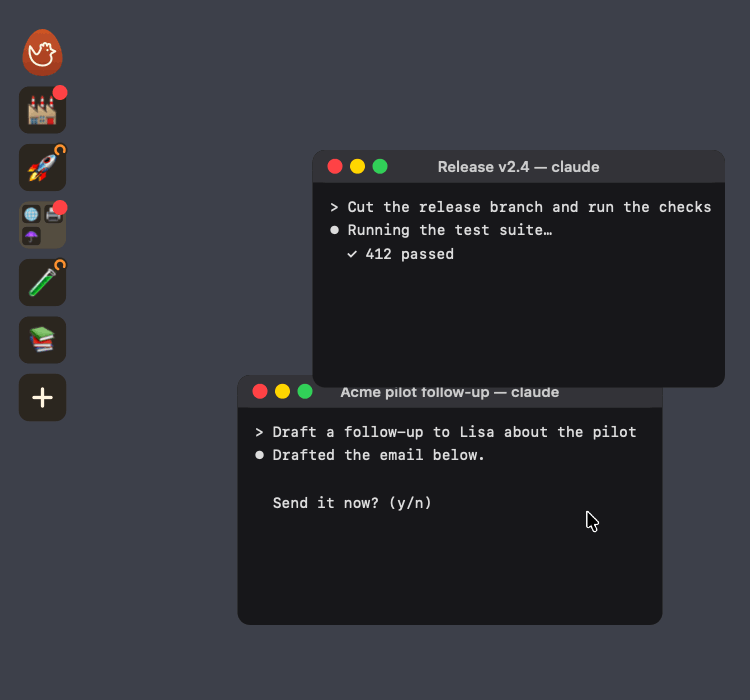

# Roost

**Never leave an agent waiting.** Roost puts every Claude Code session on the edge of your screen as an app icon. A red dot means it needs you. One click brings its Terminal window to the front.



Roost is for one person who runs many Claude Code sessions at once in Terminal on a Mac. It reads the session files that Claude Code already writes, so you keep your terminal and your habits. Nothing leaves the Mac. Who it is for and why: [docs/positioning.md](docs/positioning.md).

## Install

Paste this into Claude Code:

```text
Install Roost for me. Follow "Install steps" in https://github.com/janwilmake/roost/blob/main/README.md
```

Claude builds the app, adds the `roost` command, and tells every Claude session about Roost. After that you can ask any session to rename itself, change its picture or join a topic. To install by hand, follow the same [Install steps](#install-steps).

## Use

Roost is a strip of app-style tiles that stays on top in the top-left corner of each screen. It has no other window. To pin the Dock icon, right-click it and choose Options, Keep in Dock.

| Action                    | Result                                                                        |
| ------------------------- | ----------------------------------------------------------------------------- |
| Hover a tile              | It grows like the Dock. A label shows the title, status, folder and times.    |
| Click a session           | Its Terminal window comes forward and flashes an orange border.               |
| Drag a tile               | It moves to a new place in the priority order. New sessions start at the end. |
| Right-click a session     | Open, Rename, Mark as Seen, Snooze or Wake, Move to Topic.                    |
| Click a topic             | It expands or collapses.                                                      |
| Right-click a topic       | Expand or Collapse, Rename, Delete Topic. Deleting keeps the sessions.        |
| Click the rooster         | The overview opens: every session with its title, status and notes.          |
| Drag the rooster          | The strip moves on every screen. Right-click it to quit.                      |
| Click the + tile          | Start a session in a frequent folder or a new one, or resume a recent one.    |

When the tiles do not fit on the screen, they all shrink, the way the Dock does. The tile under the cursor still grows to full size.

A red dot means the session needs you, and a small orange spinner means it is working. A red badge with a number counts what waits for you: the `Waiting for us` header of the notes, or else the items under `Waiting for you`. A topic adds up the badges of its sessions. A snoozed session is dimmed. A topic shows the dot or spinner of its most urgent session. A stripe marks the end of an expanded topic.

The + tile opens a new Terminal window that runs `claude --dangerously-skip-permissions` in the folder. The most used folders come from `~/.claude/history.jsonl`, counted in sessions, without the `cca` agent slots. A folder that Claude has not seen before first asks if you trust it.

A session joins a topic when you drop it directly under the topic tile, or between two of its sessions. Use Rename with an empty title to return to the automatic title. For a `cca` agent with no viewer window, Roost opens one with `screen -r`.

| Status   | Meaning                                                                  |
| -------- | ------------------------------------------------------------------------ |
| Needs me | Claude waits on a prompt, or finished a turn that you did not look at.   |
| Working  | Claude itself is busy.                                                   |
| Shell    | Claude only waits on a long-running shell command. It has no indicator.  |
| Quiet    | Claude is idle and you saw the result.                                   |
| Snoozed  | Hidden from the count until the time you chose.                          |

## For AI agents: make a topic

Pass the ids of the sessions that belong in it. A new topic starts expanded:

```bash
jq -n --arg name 'Customers' '{name: $name, sessionIds: ["<id>", "<id>"]}' |
  curl -s -o /dev/null -w '%{http_code}\n' -X POST -H 'content-type: application/json' -d @- http://127.0.0.1:4777/api/topics
```

To add one session later, send `{"topic":"<topic id>"}` to `/api/sessions/<id>`. The response of `GET /api/sessions` lists `topics` with their ids.

## For AI agents: write notes

Notes show in full when the user hovers the session, and in the overview that opens from the rooster. Use this format, and leave out a section that is empty:

```text
About: one line on what this session is for.
Waiting for you:
- each thing the user must do or decide
Waiting for others:
- each thing an outside party must do, with who
```

A session about a customer starts its notes with this header. The counts are the items in the two lists. "Who" names both sides: the person on our team and the person at the customer. "When" is a date and time, for example `Tue 10 Nov 14:05`. Write `none found` when a value is not known. A session about several customers gives the header once per customer, with the customer's name in front.

```text
Waiting for us: 2 · Waiting for them: 1
Last meeting: Sam with Lisa (Acme), Tue 10 Nov 14:00
Last message: Lisa (Acme) → Robin, Tue 10 Nov 16:12 (email)
Next meeting: Sam with Lisa (Acme), Thu 12 Nov 10:00
```

Keep them under 300 words. Update them at the end of each turn in which one of the lists changed. Roost shows how old the notes are.

```bash
jq -n --arg notes "$NOTES" '{notes: $notes}' |
  curl -s -o /dev/null -w '%{http_code}\n' -X POST -H 'content-type: application/json' -d @- http://127.0.0.1:4777/api/sessions/<id>
```

The value is plain text of at most 3,000 characters. Send `null` to remove the notes.

## For AI agents: message another session

Claude Code's `SendMessage` tool reaches another local session by the name that `ListAgents` shows. Roost gives that name as `agentName`, next to the title, topic and notes. So one request finds the sessions to message, for example every session in a topic:

```bash
curl -s http://127.0.0.1:4777/api/sessions |
  jq -r --arg topic 'Customers' '(.topics[] | select(.name == $topic) | .id) as $id | .sessions[] | select(.topic == $id) | [.agentName, .title] | @tsv'
```

## For AI agents: set a session's picture

The app has no picture controls. An agent sets each picture through the local API while Roost runs. A Claude Code hook, `bin/picture-hook.sh`, asks each session that has no picture to set one.

Pick the picture in this order:

1. The thread is with one person: use a photo of that person.
2. The thread is with an organization, not one person: use its logo.
3. Neither: be creative. Use one emoji that fits the subject, or a fitting picture from elsewhere.

Use any tool you have to find it: your own CRM or database (read-only), a LinkedIn or Slack profile, or the `apple-touch-icon.png` of the organization's website. Put a pointer to your own sources in `~/.claude/CLAUDE.md`. The picture stays on this Mac, in `~/.roost/state.json`.

A session finds its own id with `jq -r .sessionId ~/.claude/sessions/$PPID.json`. To find another session, list them all:

```bash
curl -s http://127.0.0.1:4777/api/sessions | jq -r '.sessions[] | [.id, .title] | @tsv'
```

Set an emoji. A photo takes priority over an emoji, so clear the photo if the session has one:

```bash
curl -s -o /dev/null -w '%{http_code}\n' -X POST -H 'content-type: application/json' \
  -d '{"emoji":"🧪","photo":null}' http://127.0.0.1:4777/api/sessions/<id>
```

Set a photo. Crop it to a square first if it is not square. The strip shows it at up to 80 points, so 256 pixels stays sharp on a Retina screen:

```bash
sips -s format jpeg -z 256 256 face.png --out face.jpg
jq -n --arg photo "data:image/jpeg;base64,$(base64 -i face.jpg)" '{photo: $photo}' |
  curl -s -o /dev/null -w '%{http_code}\n' -X POST -H 'content-type: application/json' -d @- \
  http://127.0.0.1:4777/api/sessions/<id>
```

The value must be a base64 `data:image/jpeg`, `png` or `webp` URL of at most 400,000 characters. The API answers 200 on success and 400 on a bad value. The same request also accepts `title`. A session without a picture shows a default animal.

## Install steps

Do these steps in order. Tell the user what you did at the end. In the commands, `$ROOST` is the folder of the clone.

1. **Check the requirements.** You need macOS 13 or later, Node 20 or later (`node -v`), `jq` (`jq --version`), and Swift (`swiftc --version`). If Swift is missing, ask the user to run `xcode-select --install`, and stop until it is installed.
2. **Clone.** Clone `https://github.com/janwilmake/roost` into `~/roost`, unless the user names another folder. If the clone already exists, run `git pull` in it.
3. **Build.** In `$ROOST`, run `./scripts/build-app.sh`. It builds `~/Applications/Roost.app`. Run it again after a change of the Node version or a move of the folder.
4. **Add the command.** Run `mkdir -p ~/.local/bin && ln -sf "$ROOST/bin/roost.js" ~/.local/bin/roost`. If `~/.local/bin` is not on the `PATH`, tell the user.
5. **Add the picture hook.** It asks each session without a picture to set one. This command keeps every other setting and adds the hook only once:

   ```bash
   f=~/.claude/settings.json; [ -f "$f" ] || echo '{}' > "$f"
   jq --arg cmd "$ROOST/bin/picture-hook.sh" \
     'if any(.hooks.UserPromptSubmit[]?.hooks[]?; .command == $cmd) then . else .hooks.UserPromptSubmit += [{hooks: [{type: "command", command: $cmd, timeout: 5}]}] end' \
     "$f" > "$f.tmp" && mv "$f.tmp" "$f"
   ```

6. **Tell every session about Roost.** Add this note to the end of `~/.claude/CLAUDE.md`. Create the file if it does not exist. Skip this step if the file already has a Roost note. Replace `$ROOST` with the real path:

   ```markdown
   # Roost

   Roost is the strip of session icons at the left edge of the screen. It shows every running Claude Code session with a picture, a title and a status. When someone asks how Roost works, or asks to change this session's title, picture, notes, topic or place in the strip, read `$ROOST/README.md` and use its local API. This session's id: `jq -r .sessionId ~/.claude/sessions/$PPID.json`. Keep this session's Roost notes current, in the format the README gives.
   ```

7. **Open Roost.** Run `open ~/Applications/Roost.app`. Tell the user that macOS asks once for permission to control Terminal, and that Roost needs it. The hook and the note work in sessions that start after the install.

## How it works

- `src/server.js` listens on `127.0.0.1:4777` only. It refuses other hosts and origins.
- It reads `~/.claude/sessions/<pid>.json`, `ps`, and the Terminal tab list through AppleScript. It never opens the `.key` files in that folder.
- Pictures, titles, order and snooze times are in `~/.roost/state.json`, keyed by session id. A resumed session keeps them.
- `app/main.swift` is the native app. It starts the server if needed, draws the strip and the logo, and reads the sessions from the server.

The session files are an undocumented part of Claude Code. If the list goes empty after an update, look there first.

Settings for tests: `ROOST_PORT`, `ROOST_HOME`, `ROOST_SESSIONS_DIR`. Run the tests with `npm test`.
